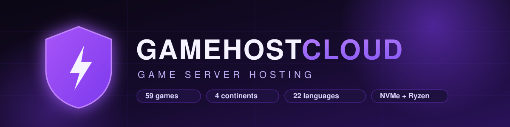

  

    

  
  
  
  

 

# GameHostCloud

**Dedicated game server hosting on real hardware — no noisy neighbors, no hidden throttling.**
One-click servers for 59 titles, deployed in under 60 seconds on NVMe + Ryzen infrastructure across four continents, with real-time latency shown from *your* browser before you buy — never estimates.

Built in Finland by [HHI Solutions Oy](https://gamehostcloud.com).

---

## What we run

| | |
|---|---|
| **Game server hosting** | 59 titles, three hardware tiers (Budget / Standard / Premium), instant provisioning, off-site backups, DDoS-protected network, RCON + file manager + console in the panel |
| **LiveSub** | Real-time speech-to-speech translation and live captions for streams — OBS overlay, studio preview, regional ingest |
| **Control panel** | Custom-built panel: server lifecycle, versioning, mod management, SFTP, schedulers, teams & workspaces |
| **Regions** | Europe (Helsinki · Frankfurt), North America (Chicago), Asia-Pacific (Sydney · Singapore) — with regional database replicas for a fast panel everywhere |

---

## Supported games

<b>Survival & Sandbox</b>

 

`Minecraft` · `Valheim` · `7 Days to Die` · `ARK: Survival Evolved` · `ARK: Survival Ascended` · `Rust` · `Palworld` · `Enshrouded` · `V Rising` · `Conan Exiles` · `The Forest` · `Sons of the Forest` · `Don't Starve Together` · `Raft` · `Project Zomboid` · `SCUM` · `Unturned` · `Eco` · `Icarus` · `Grounded` · `Terraria` · `Vintage Story` · `Core Keeper` · `Creativerse` · `Necesse` · `Myth of Empires` · `Barotrauma` · `Astroneer` · `Stationeers` · `Empyrion` · `RimWorld Together`

<b>FPS & Tactical</b>

 

`Counter-Strike 2` · `CS:GO (Legacy)` · `Counter-Strike: Source` · `Counter-Strike 1.6` · `Team Fortress 2` · `Insurgency: Sandstorm` · `Left 4 Dead 2` · `Squad` · `Hell Let Loose` · `Pavlov VR` · `DayZ` · `Mordhau` · `Chivalry 2` · `SCP: Secret Laboratory`

<b>Simulation, Racing & More</b>

 

`Satisfactory` · `Factorio` · `Space Engineers` · `Farming Simulator 25` · `Stormworks` · `Assetto Corsa` · `Assetto Corsa Competizione` · `Arma 3` · `Arma Reforger` · `Among Us`

<b>Communities & Platforms</b>

 

`FiveM` · `Garry's Mod` · `VRChat` · `Discord Bot Hosting`

---

## Engineering notes

- **Own control plane** — our panel, provisioning, and orchestration are built in-house (k3s + game-optimized workers), not a resold Multicraft/Pterodactyl skin.
- **Honest latency** — the ping you see on the site is measured live from your browser to every region anchor. Cities without a real anchor are marked unmeasurable rather than guessed.
- **Self-hosted stack** — auth, database, email, and game orchestration run on infrastructure we operate. Your data isn't rented out to third-party app platforms.
- **Every customer email, in your language** — 22 languages, branded transactional mail, English fallback.

---

  
    <b>GameHostCloud</b> · HHI Solutions Oy · Finland 
    <a href="https://gamehostcloud.com">Website</a> ·
    <a href="https://status.gamehostcloud.com">Status</a> ·
    <a href="https://gamehostcloud.com/support">Support</a> ·
    <a href="https://gamehostcloud.com/livesub">LiveSub</a>  
    <i>This organization profile is our public face. Production code lives in private repositories.</i>
  

