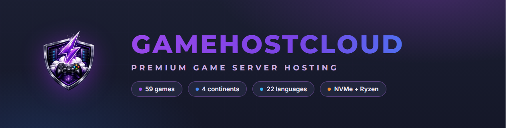

  

    

  
  
  
  
  

 

<h1 align="center">GameHostCloud</h1>

<b>Dedicated game server hosting on real hardware — no noisy neighbors, no hidden throttling.</b> 
One-click servers for 59 titles, deployed in under 60 seconds on NVMe + Ryzen infrastructure across four continents, 
with real-time latency shown from <i>your</i> browser before you buy — never estimates.  
Built in Finland by <a href="https://gamehostcloud.com">HHI Solutions Oy</a>.

---

## Why players choose GameHostCloud

<table>
  <tr>
    <td width="33%"><b>Instant provisioning</b> From order to a running server in under 60 seconds — automated builds on dedicated k3s workers, not queued manual setups.</td>
    <td width="33%"><b>Honest latency</b> Every ping on our site is measured live from your browser to real regional anchors. Cities without a true anchor are marked unmeasurable — never guessed.</td>
    <td width="33%"><b>Real hardware</b> Ryzen CPUs, NVMe storage, generous RAM tiers. Budget, Standard and Premium classes — what you buy is what you get.</td>
  </tr>
  <tr>
    <td><b>Full control panel</b> Version switching, mod & plugin management, SFTP, schedulers, live console, off-site backups, team workspaces — built in-house.</td>
    <td><b>Safe by design</b> DDoS-protected network, isolated game containers, encrypted auth, self-hosted stack — your data isn't rented to third-party platforms.</td>
    <td><b>Every language</b> Panel and all customer emails in 22 languages — always in the customer's language, English as fallback.</td>
  </tr>
</table>

---

## What we run

| | |
|---|---|
| **Game server hosting** | 59 titles, three hardware tiers (Budget / Standard / Premium), instant provisioning, off-site backups, DDoS-protected network, RCON + file manager + console in the panel |
| **LiveSub** | Real-time speech-to-speech translation and live captions for streams — OBS overlay, studio preview, regional ingest |
| **Control panel** | Custom-built panel: server lifecycle, versioning, mod management, SFTP, schedulers, teams & workspaces |
| **Regions** | Europe (Helsinki · Frankfurt), North America (Chicago), Asia-Pacific (Sydney · Singapore) — with regional replicas for a fast panel everywhere |

---

## Supported games

<b>Survival &amp; Sandbox — 32 titles</b>

 

`Minecraft` · `Valheim` · `7 Days to Die` · `ARK: Survival Evolved` · `ARK: Survival Ascended` · `Rust` · `Palworld` · `Enshrouded` · `V Rising` · `Conan Exiles` · `The Forest` · `Sons of the Forest` · `Don't Starve Together` · `Raft` · `Project Zomboid` · `SCUM` · `Unturned` · `Eco` · `Icarus` · `Grounded` · `Terraria` · `Vintage Story` · `Core Keeper` · `Creativerse` · `Necesse` · `Myth of Empires` · `Barotrauma` · `Astroneer` · `Stationeers` · `Empyrion` · `RimWorld Together`

<b>FPS &amp; Tactical — 14 titles</b>

 

`Counter-Strike 2` · `CS:GO (Legacy)` · `Counter-Strike: Source` · `Counter-Strike 1.6` · `Team Fortress 2` · `Insurgency: Sandstorm` · `Left 4 Dead 2` · `Squad` · `Hell Let Loose` · `Pavlov VR` · `DayZ` · `Mordhau` · `Chivalry 2` · `SCP: Secret Laboratory`

<b>Simulation, Racing &amp; More — 10 titles</b>

 

`Satisfactory` · `Factorio` · `Space Engineers` · `Farming Simulator 25` · `Stormworks` · `Assetto Corsa` · `Assetto Corsa Competizione` · `Arma 3` · `Arma Reforger` · `Among Us`

<b>Communities &amp; Platforms — 4 titles</b>

 

`FiveM` · `Garry's Mod` · `VRChat` · `Discord Bot Hosting`

---

## Engineering notes

- **Own control plane** — our panel, provisioning, and orchestration are built in-house (k3s + game-optimized workers), not a resold Multicraft/Pterodactyl skin.
- **Honest latency** — the ping you see on the site is measured live from your browser to every region anchor. Cities without a real anchor are marked unmeasurable rather than guessed.
- **Self-hosted stack** — auth, database, email, and game orchestration run on infrastructure we operate. Your data isn't rented out to third-party app platforms.
- **Every customer email, in your language** — 22 languages, branded transactional mail, English fallback.

---

## Community &amp; links

[Website](https://gamehostcloud.com) · [Game catalog](https://gamehostcloud.com/games) · [Status](https://status.gamehostcloud.com) · [LiveSub](https://gamehostcloud.com/livesub) · [Support](https://gamehostcloud.com/support) · [Trustpilot](https://www.trustpilot.com/review/gamehostcloud.com)

 

  
    <b>GameHostCloud</b> · HHI Solutions Oy · Finland 
    This organization profile is our public face. Production code lives in private repositories.
  

